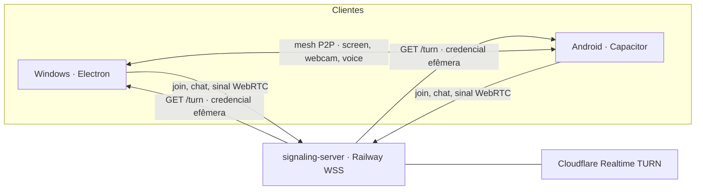

# Concord

[](https://github.com/PedroHRoseno/concord/releases/latest)
[](https://github.com/PedroHRoseno/concord/actions/workflows/ci-check.yml)
[](https://www.electronjs.org/)
[](https://react.dev/)
[](https://www.typescriptlang.org/)
[](https://webrtc.org/)
[](https://capacitorjs.com/)

Alternativa leve e P2P para compartilhar tela em até 1440p/60 fps, levar a câmera no 4G e falar em tempo real. O vídeo não passa por um servidor de mídia: Windows e Android se conectam direto, em mesh WebRTC. O servidor só apresenta as pessoas da sala e entrega uma credencial temporária de TURN quando a rede móvel não deixa a conexão sair.

[Baixar para Windows](https://github.com/PedroHRoseno/concord/releases/latest) · [Baixar APK Android](https://github.com/PedroHRoseno/concord/releases/latest)

Na Release mais recente, o instalador é o `Concord Setup X.Y.Z.exe` (NSIS one-click, por usuário, sem assistente) e o app é o `Concord-Android-vX.Y.Z.apk`. Os dois já apontam para o servidor de sinalização publicado. Entre com um nome e o mesmo ID de sala.

## Destaques

### Live stream P2P

Tela e webcam em mesh, com preset até 1440p e 60 fps, teto de bitrate e estatísticas ao vivo. O áudio do sistema no Windows usa WASAPI loopback: a tela inteira exclui o próprio Concord, e uma janela captura só o processo alvo. O espectador amplifica essa trilha de 0 a 300%.

### Palco livre

Os cards arrastam e redimensionam. O Modo Grade separa as faixas (webcam sempre acima da tela) e o Modo Foco destaca uma transmissão, inclusive uma webcam quando não há tela. Em tela cheia, as câmeras viram PiP e a barra some sozinha.

### Voz Opus e chat

A voz é uma track à parte, Opus mono a 48 kHz com FEC. O anel verde marca quem está falando. Cada pessoa tem volume de 0 a 200%, mute e ensurdecer. O chat leva texto, links e print colado, comprimido para WebP antes de entrar no WebSocket. O histórico da sala guarda as últimas 100 mensagens e some quando todo mundo sai.

### Modo IRL no Android

O mesmo renderer vai para um app Capacitor. No celular não há compartilhamento de tela: a câmera troca de frontal para traseira sem derrubar a chamada, a tela pode ficar acesa e o TURN da Cloudflare atravessa o CGNAT do 4G/5G. O perfil de câmera no aparelho é 720p, 30 fps e cerca de 2 Mbps.

## Arquitetura



| Peça | Onde está | Função |
| --- | --- | --- |
| Desktop | `desktop-app` | Electron 45, React 19 e Vite. O processo main isola WASAPI, atalhos, updater e Discord. |
| Android | `mobile` | Capacitor 8. O `webDir` é o build `desktop-app/dist-mobile`. O Capacitor não entra nas dependências do Electron. |
| Sinalização | `signaling-server` | WebSocket em memória, `GET /health` e `GET /turn`. Sem banco. |
| CI | `.github/workflows` | `ci-check.yml` em todo push na `main`. `release-windows.yml` numa tag `v*`: primeiro o `.exe`, depois o APK assinado na mesma Release. |

## Desenvolvimento

Requisito: Node.js 22. Na raiz:

```powershell
npm install
npm run dev:signaling
npm run dev:app
```

O sinalizador sobe em `ws://localhost:8080`. No lobby, aponte a URL para esse endereço. `Ctrl+Shift+N` abre outra janela na mesma máquina.

O renderer mobile, sem o Android SDK:

```powershell
npm run build:mobile
```

O projeto Android e o sync do Capacitor:

```powershell
npm run build:android
```

`build:android` exige o SDK e o Java. A assinatura só acontece quando `ANDROID_KEYSTORE_PATH`, `ANDROID_KEYSTORE_PASSWORD`, `ANDROID_KEY_ALIAS` e `ANDROID_KEY_PASSWORD` estão definidas. Sem a keystore, o APK de release sai sem assinatura.

### Railway

O serviço usa `signaling-server/Dockerfile` e `signaling-server/railway.json`. Variáveis:

| Variável | Uso |
| --- | --- |
| `PORT` | Porta HTTP. O Railway define a dele; localmente o padrão é `8080`. |
| `HOST` | Bind. Padrão `0.0.0.0`. |
| `CF_TURN_KEY_ID` | Identificador da chave Cloudflare Realtime TURN. |
| `CF_TURN_API_TOKEN` | Token dessa chave. Não vai para o cliente. |

Sem as duas variáveis da Cloudflare, `/turn` responde só com STUN e as salas em rede aberta continuam funcionando.

### GitHub Actions

Secrets do repositório, nunca do código:

| Secret | Uso |
| --- | --- |
| `VITE_SIGNALING_URL` | URL `wss://` gravada no `.exe` e no APK. |
| `ANDROID_KEYSTORE_BASE64` | Keystore de release, em base64. |
| `ANDROID_KEYSTORE_PASSWORD` | Senha do arquivo. |
| `ANDROID_KEY_ALIAS` | Alias da chave. |
| `ANDROID_KEY_PASSWORD` | Senha da chave. |

Uma tag `vX.Y.Z` dispara o instalador Windows e, em seguida, `Concord-Android-vX.Y.Z.apk`. A versão em `desktop-app/package.json` e `mobile/package.json` acompanha a tag. Um disparo manual sem tag guarda o APK como artefato.

Modelos sem segredo: [`.env.example`](.env.example), [`signaling-server/.env.example`](signaling-server/.env.example) e [`desktop-app/.env.example`](desktop-app/.env.example). O histórico de cada versão está no [CHANGELOG](CHANGELOG.md).

O repositório ainda não inclui um arquivo `LICENSE`.
